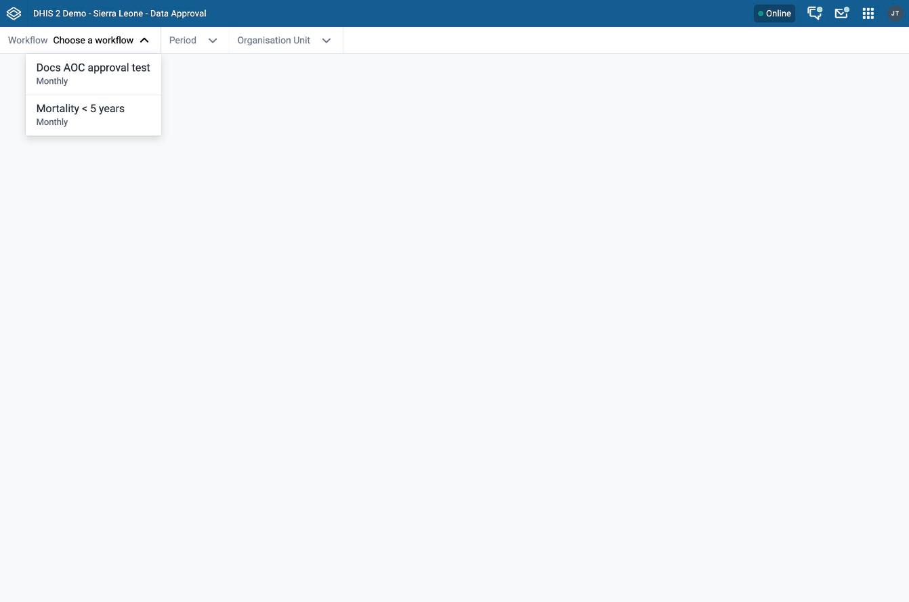
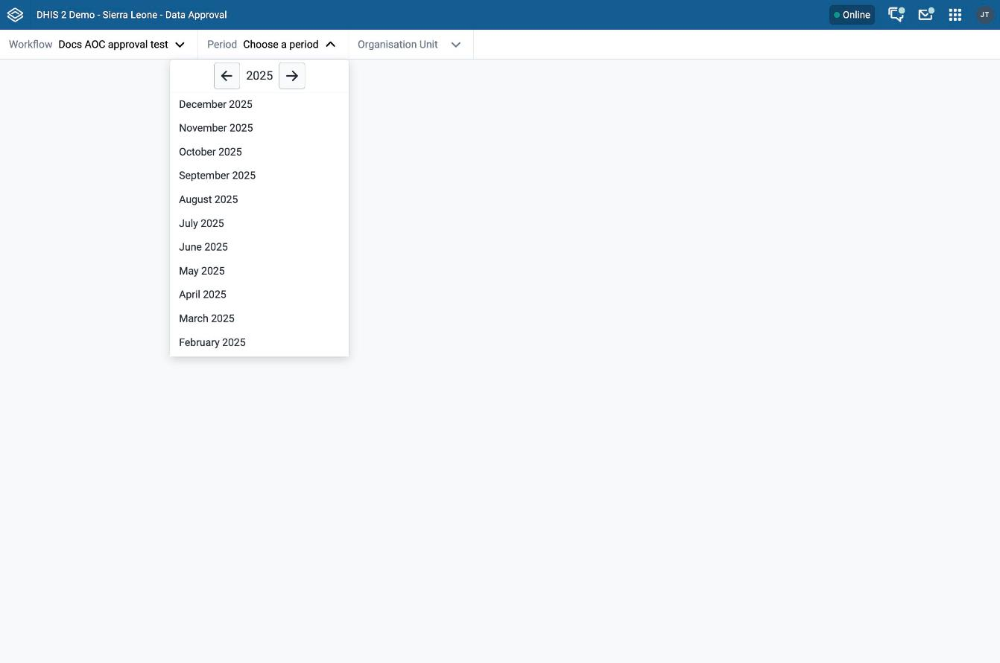
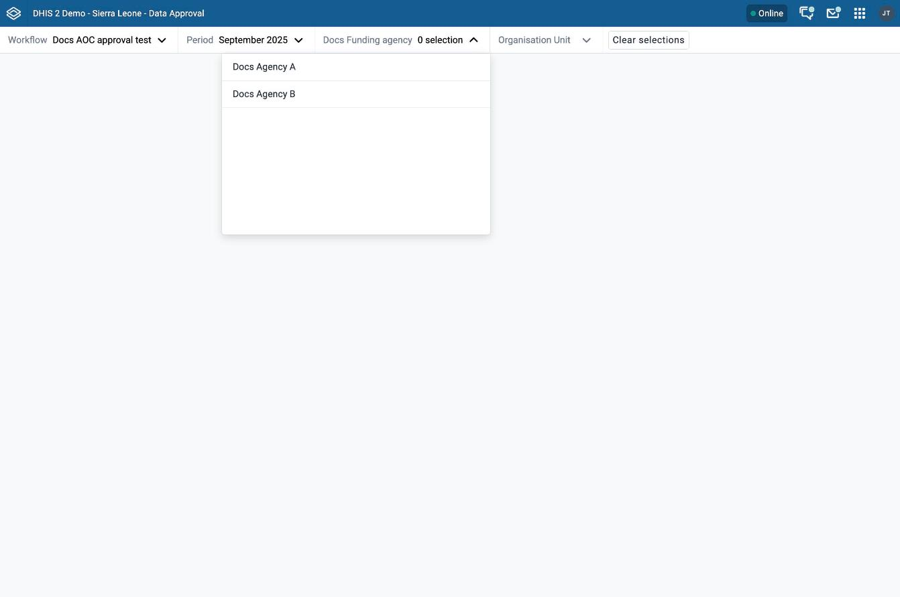
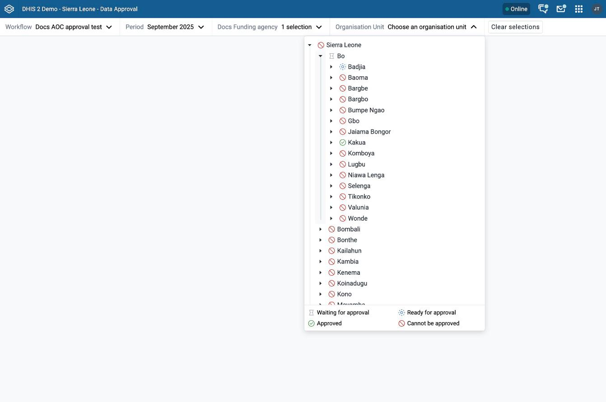
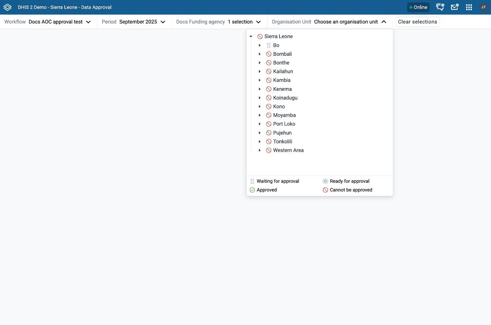
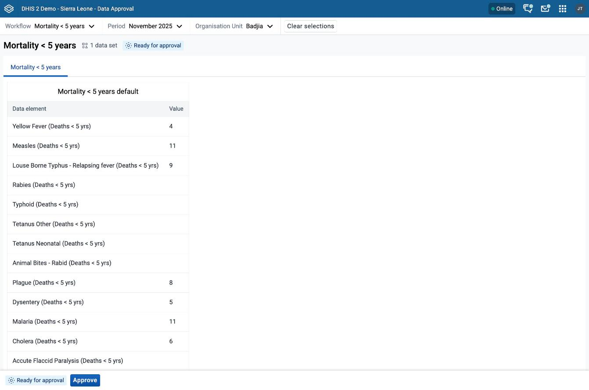
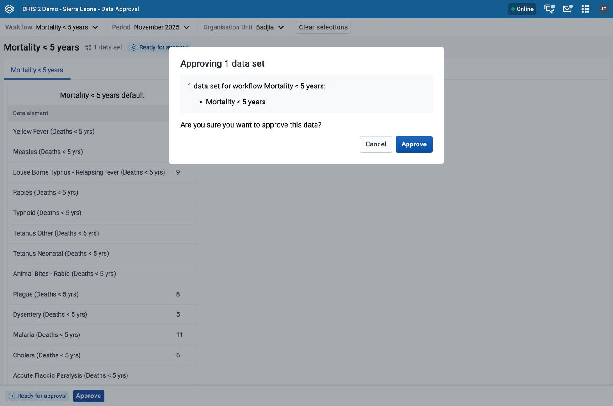
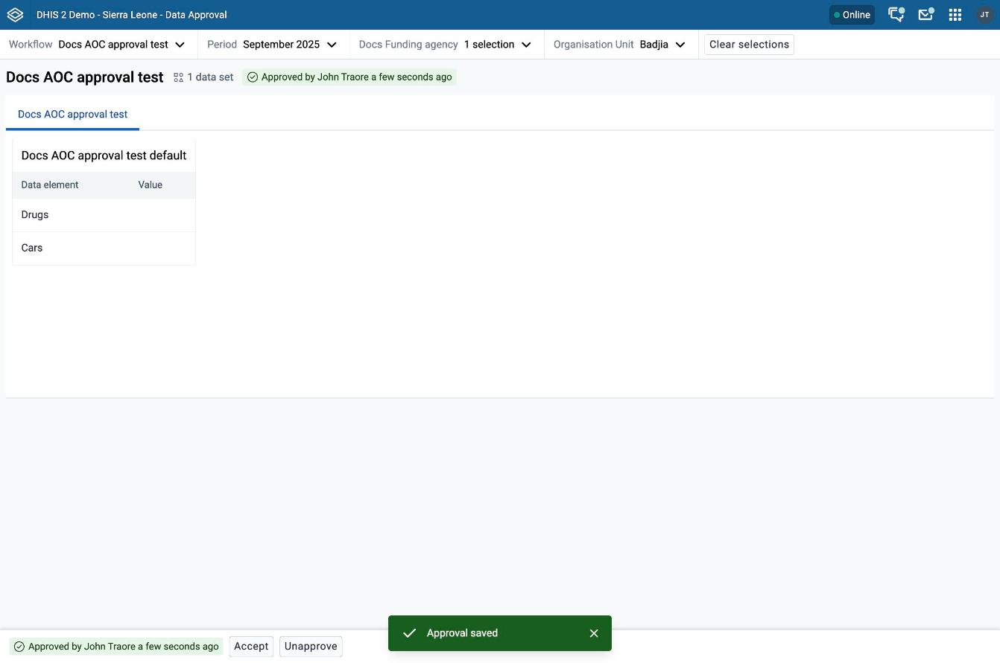

# Data Approval { #data_approval_app }

The Data Approval app lets you review data and approve it, according to the approval workflows configured in your system. You open it from the App Menu.

For an overview of the parts of data approval, see [Approving data](#approving_data). For how approval works, see [Understanding data approval](#understanding_data_approval). For the authorities you need, see [Authorities for approving data](#data_approvals_authorities). For how an administrator configures approval levels and workflows, see [Approval levels and workflows](#data_approvals_configuration). For which users can see data at each approval level, see [Data visibility](#data_approvals_data_visibility).

## Choose a workflow, period, and organisation unit { #data_approval_app_choose }

The bar at the top of the app has one menu for each choice. You choose a workflow and a period first. If the data sets in the workflow use a category combination, you also choose an attribute option combo. Then you choose an organisation unit. The **Period** and **Organisation Unit** menus stay unavailable until the choices before them are made. Point to an unavailable menu to see what you must choose first.

### Choose a workflow

Open the **Workflow** menu and choose a workflow. The menu shows the period type under each workflow name. If you have access to only one workflow, the app chooses it for you.

### Choose a period

Open the **Period** menu and choose a period. The periods have the period type of the workflow. Use the arrow buttons at the top of the menu to move to another year.

### Choose an attribute option combo { #data_approval_app_aoc }

Some data sets are linked to a category combination, for example one that splits data by implementing partner or by project. DHIS2 stores such data against an _attribute option combo_, which is one option from each category in the combination. Approval applies to one attribute option combo at a time, so you choose it before you choose an organisation unit.

The app shows the attribute option combo menu only when it is needed:

-   If the data sets in the workflow use only the default category combination, the menu does not appear. The app uses the default combination for you.
-   If the workflow has one category combination with one category, and only one option of that category is valid for the period, the menu does not appear. The app uses that option for you.
-   In other cases, the menu appears after you choose a workflow and a period.

The menu is named after the category combination, or **Attribute Option Combo** until a combination is known. Its value shows how many options you have chosen, for example **1 selection**.

To choose an attribute option combo:

1.  If the workflow's data sets use more than one category combination, choose a combination in the first menu, **Choose a combination**.
2.  If the combination has one category, choose an option from the list. If the list has 10 or more options, you can type in the **Type to filter options** box to narrow it.
3.  If the combination has more than one category, choose an option in every category. You can type in each menu to filter its options.
4.  If the menu has a **Hide menu** button, click it to close the menu. A menu for a single category has no such button; click outside the menu to close it.

You can choose only one option in each category. If you choose another option in the same category, it replaces the first one, and the menu still shows **1 selection**.

The options in each category are limited to options that are valid for the period you chose. An option is not listed if its start date is after the start of the period, or its end date is before the end of the period. If a category has no valid option, the menu shows **No available options**.

The attribute option combo you choose decides which data sets you review. The app shows only the data sets that use the same category combination and are assigned to the organisation unit that you choose, or to an organisation unit below it. The data in each data set report is limited to the options you chose.

If you change the workflow or the period later, the app keeps your attribute option combo only when it is still valid. If it is not, choose it again.

#### Data Approval app version 100.0 and earlier

These versions have no attribute option combo menu. You cannot choose an attribute option combo for a data set that uses a category combination. DHIS2 2.41.7 and earlier, and 2.42.3 and earlier, include these versions. To get the attribute option combo menu on those versions, update the Data Approval app in the App Management app.

### Choose an organisation unit

Open the **Organisation Unit** menu and choose the organisation unit that you want to approve data for. Each organisation unit in the tree has a status icon. The icon shows the actions that are available to you for that organisation unit, for the workflow, period, and attribute option combo you chose. In the following example, Badjia has the status **Ready for approval**. The legend under the tree explains each icon: **Waiting for approval**, **Ready for approval**, **Approved**, and **Cannot be approved**.

When the workflow has an attribute option combo menu, the **Organisation Unit** menu stays unavailable until you choose an option, and the status icons show the status for the option you chose. If you choose a different option, the icons change.

### Clear selections

As soon as you choose a period, an attribute option combo, or an organisation unit, the **Clear selections** button appears. Click it to clear your choices and start again. If you have access to only one workflow, the app keeps that workflow.

## Approve data { #data_approval_app_approve }

### Review the data set reports

After you choose a workflow, period, attribute option combo, and organisation unit, the app shows the data set reports for the data sets in the workflow. The heading of the reports shows the workflow name, the number of data sets, and the approval status. The report of each data set opens in its own tab. If the workflow has more than one data set, choose a tab to see its report.

A data set can have a different period type from the workflow. In that case, the app shows data for all periods of the data set that end within the period you chose.

If no data set matches your choices, the app tells you that the workflow, organisation unit, and attribute option combo have no data sets.

### Take an approval action

After you review the data, you can take an approval action. The actions are:

-   **Approve**
-   **Accept**
-   **Unapprove**
-   **Unaccept**

The actions you can take depend on the actions already taken at this and other levels of the organisation unit hierarchy, and on your authorities. Each action applies to the workflow, period, organisation unit, and attribute option combo that you chose.

When you click **Approve**, a dialog lists the data sets that you are approving. Click **Approve** in the dialog to confirm, or click **Cancel**. The other actions take effect at once, without a confirmation step.

After you confirm, the app shows the message **Approval saved** and updates the approval status.

### Approval status

The app shows the approval status in two places:

-   In the heading of the reports, next to the workflow name.
-   In the bottom bar, next to the buttons.

The two tags can show different information because they have different meanings:

-   The tag in the heading of the reports shows the approval status of the workflow for the period, organisation unit, and attribute option combo that you chose.
-   The tag in the bottom bar shows the same status, and it also takes your authorities into account.

The data can be ready for approval at an organisation unit, but you can still lack the authority to approve it. In that case, the bottom bar shows **You do not have authority to approve data**.

The tags use the following texts:

| Tag                                        | Meaning                                                                                  |
| ------------------------------------------ | ---------------------------------------------------------------------------------------- |
| **Ready for approval**                     | The data can be approved now.                                                            |
| **Waiting for lower level approval**       | The data must first be approved at the lower levels.                                     |
| **Approved by** a user and a time          | The data is approved at this level. Point to the tag to see the date and time.           |
| **Approval by** a user **accepted** a time | The data is approved and accepted at this level.                                         |
| **Approved at higher level**               | The data is approved at a higher level.                                                  |
| **Waiting for higher level approval**      | The data is waiting for approval at a higher level. You cannot approve it at this level. |
| **Cannot be approved**                     | Approval does not apply to the data you chose.                                           |
| **Could not retrieve approval status**     | The app could not load the approval status.                                              |
